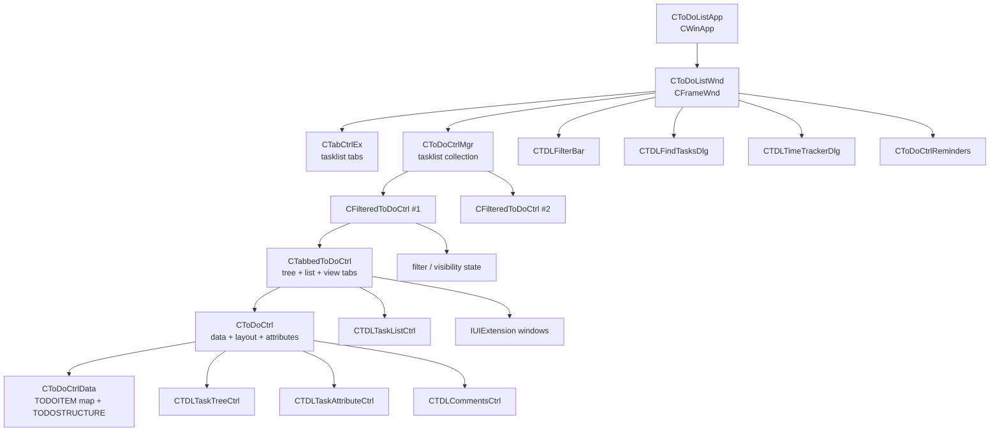
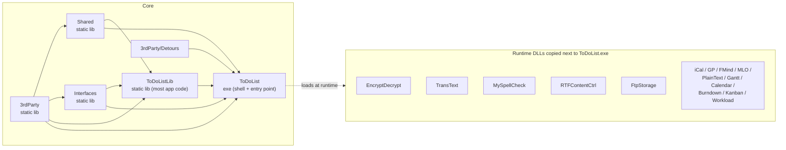
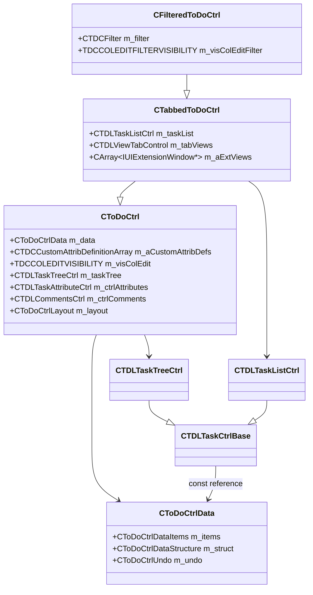
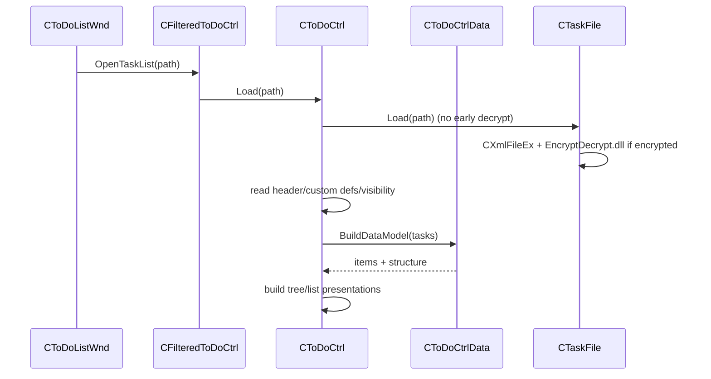
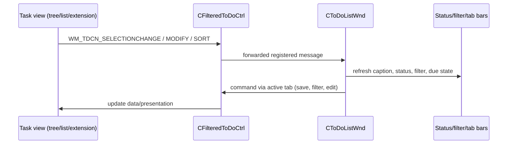

# ToDoList (Windows / MFC) — Architecture

> Scope: this document describes the **Core/ToDoList** application. Other projects are
> included only where they are required dependencies or extension points. See
> [PROJECT_SCOPE.md](PROJECT_SCOPE.md) for the include/exclude decision table and
> [DATA_MODEL.md](DATA_MODEL.md) for a detailed data-model reference.

- Solution: `Core/ToDoList_Core.sln` (26 projects) — minimal runtime subset: `Core/ToDoList_Only.sln` (7 projects)
- Start project / exe: `Core/ToDoList/ToDoList.vcxproj` → `ToDoList.exe`
- Language / UI: C++ / MFC (Unicode), Win32 only
- Toolset: `v143` (Visual Studio 2022), configurations `Unicode Debug|Win32` and `Unicode Release|Win32`
- Bulk of the code is compiled into **`Core/ToDoListLib`**, not into the exe (see §2)
- Size of `Core/ToDoList`: ~167 `.cpp` / ~175 `.h`, ~133k lines

---

## 1. What kind of application is this?

ToDoList is a **single-instance, tabbed, multi-tasklist desktop application built on MFC
without MFC Document/View**. There is no `CDocument`/`CView`; instead:

- `CToDoListWnd` (a `CFrameWnd`) is the application shell and owns the menu, toolbars,
  status bar, filter bar, tasklist tab strip, find dialog, time tracker and reminders.
- Each open tasklist is a `CFilteredToDoCtrl` window placed in a tab.
- A separate `CToDoCtrlMgr` tracks the tasklist collection and maps tab index ↔ control.
- Each tasklist control owns its own **in-memory task database** (`CToDoCtrlData`),
  its task tree/list views, attribute editor and comments pane.
- Cross-cutting services (preferences, localisation, import/export, storage, UI
  extensions, encryption, content editors) are **DLL plugins discovered at runtime**
  from the executable directory, behind interfaces declared in `Core/Interfaces`.

The result is a document-like UX (multiple tasklists, modified flags, save/close
prompts) implemented with plain MFC windows and a manager, not with MFC's document
architecture.



---

## 2. Build and project topology



Facts:

- `Core/ToDoList/ToDoList.vcxproj` compiles only `StdAfx.cpp` and `ToDoList.cpp` and
  links `ToDoListLib.lib` + `Shared.lib` + `Interfaces.lib` + `3rdParty.lib` + `detours.lib`.
- `Core/ToDoListLib/ToDoListLib.vcxproj` compiles the rest of `Core/ToDoList/*.cpp`
  (task model, controllers, views, persistence, dialogs, preferences) and has **no
  project references of its own** — it is also consumed by `Plugins/PluginHelpers`.
- `Core/Interfaces` contains both contracts (`ITaskList.h`, `IUIExtension.h`, …) and
  manager/base implementations (`ContentMgr`, `ImportExportMgr`, `TasklistStorageMgr`,
  `UIExtensionMgr`, `CPreferences`).
- `Core/Shared` is the generic MFC utility layer (controls, dialogs, file/XML helpers,
  graphics, date/time, localisation, Office automation).
- `Core/3rdParty` is the reusable native support layer (charts, controls, XML/HTML,
  crypto/zip, Office COM wrappers, database access, Detours).
- Build entry points: `BuildDebug.bat`, `BuildRelease.bat` (repo root). They build
  `Core/ToDoList_Core.sln`, run `Core/TDLTest`, then build `Plugins/ToDoList_Plugins.sln`.
  The scripts reference legacy MSBuild/MSDev paths; the actual projects use toolset `v143`.

See [PROJECT_SCOPE.md](PROJECT_SCOPE.md) for the per-project analysis scope.

---

## 3. Startup and lifetime

`CToDoListApp::InitInstance()` (`Core/ToDoList/ToDoList.cpp:181`) performs, in order:

1. Load shared toolbar/help icons.
2. Parse the command line into `CEnCommandLineInfo` (`.tdl;.xml`).
3. Handle “simple query” switches that do not need a UI.
4. Handle restart/elevation cases.
5. `AfxOleInit()` and `AfxEnableControlContainer()` for drag/drop and embedded IE.
6. Require MSXML 3+.
7. `InitPreferences()` → `CPreferences::Initialise(...)` (registry or INI).
8. Build `CTDCStartupOptions` and let an existing instance handle the request if possible
   (single-instance behaviour via window messages).
9. Create `CToDoListWnd` and call `Create(startup)`.
10. Set `m_pMainWnd` and return.

`CToDoListWnd::Create()` (`Core/ToDoList/ToDoListWnd.cpp:1071`) creates the frame; its
`OnCreate()` initialises the menu bar, drop target, tray icon, main toolbar, status bar,
filter bar, tasklist tab control and time tracker. The frame then restores/reopens the
previous tasklist set (`ReloadTasklists`, last file, startup options).

Application exit is coordinated by `CloseAllToDoListWnds()` and the frame's close
handling, which prompts per modified tasklist and persists preferences/session state.

### Tasklist lifetime

- New tasklist: `CToDoListWnd::CreateNewTaskList()` → `NewToDoCtrl()` → `AddToDoCtrl()`.
- Open file: `CToDoListWnd::OpenTaskList()` → `NewToDoCtrl()` → `CToDoCtrl::Load()` →
  `AddToDoCtrl()`.
- Close: `CToDoListWnd::CloseToDoCtrl()` → `CToDoCtrlMgr::DeleteToDoCtrl()` destroys the
  `CFilteredToDoCtrl` window and removes the tab.
- `CToDoCtrlMgr` (`Core/ToDoList/ToDoCtrlMgr.h:36`) stores per-tasklist metadata
  (file path, storage info, loaded/modified/read-only state, due status, checkout state,
  tab colour) and is the single source of truth for “which tab is active”.

---

## 4. View architecture

### 4.1 Inheritance and responsibility split

```
CToDoCtrl : CRuntimeDlg                       (Core/ToDoList/ToDoCtrl.h:50)
└── CTabbedToDoCtrl : CToDoCtrl               (Core/ToDoList/TabbedToDoCtrl.h:44)
    └── CFilteredToDoCtrl : CTabbedToDoCtrl   (Core/ToDoList/FilteredToDoCtrl.h:17)

CTDLTaskCtrlBase : CWnd, CTreeListSyncer      (Core/ToDoList/TDLTaskCtrlBase.h:46)
├── CTDLTaskTreeCtrl : CTDLTaskCtrlBase       (Core/ToDoList/TDLTaskTreeCtrl.h:38)
└── CTDLTaskListCtrl : CTDLTaskCtrlBase       (Core/ToDoList/TDLTaskListCtrl.h:47)

CTDLViewTabControl : CTabCtrlEx               (Core/ToDoList/TDLViewTabControl.h:34)
CTDLFilterBar : CDialog, CDialogHelper        (Core/ToDoList/TDLFilterBar.h:33)
CToDoCtrlLayout                               (Core/ToDoList/ToDoCtrlLayout.h:24)
```

| Class | Responsibility |
|---|---|
| `CToDoCtrl` | Host dialog / shared services. Owns the authoritative `CToDoCtrlData m_data`, custom-attribute definitions, visibility state, layout, tree view, attribute editor, comments pane, time tracking, find/replace, source-control and reminders. Creates `m_taskTree`, `m_ctrlAttributes`, `m_ctrlComments` in `OnInitDialog()`. |
| `CTabbedToDoCtrl` | Adds the flat **list** view (`m_taskList`), the **view tab control** (`m_tabViews`), UI-extension views (`m_aExtViews`) and cross-view selection/sort/state handling. |
| `CFilteredToDoCtrl` | Adds filter state (`CTDCFilter m_filter`), filtered column/edit-field visibility and the selected-task snapshot used by “filter by selection”. Rebuilds presentations from the shared data model; it does **not** duplicate task data. |
| `CTDLTaskCtrlBase` | Common task view: title pane + attribute-columns pane, column catalogue/rendering, sorting, selection, row colours, header handling and notification plumbing. Defines pure virtuals (`GetItemCount`, `GetSelectedCount`, `SelectTasks`, `DeleteAll`, …). |
| `CTDLTaskTreeCtrl` | Hierarchical title pane backed by `CTreeCtrl`; owns `CToDoCtrlFind` and an ID→`HTREEITEM` map. |
| `CTDLTaskListCtrl` | Flat/grouped title pane backed by `CListCtrl`; supports group-by headers and sorting. |
| `CTDLViewTabControl` | Attaches/detaches views (tree, list, extension windows) as tabs, switches the active child, persists tab order/visibility. |
| `CToDoCtrlLayout` | Arranges the three logical panes (tasks, attributes, comments) with horizontal/vertical splitters, maximise states and stacked/unstacked variants. |

### 4.2 One data model, many presentations

`CToDoCtrl` owns exactly one `CToDoCtrlData m_data` (`ToDoCtrl.h:467`). All task views hold
a `const CToDoCtrlData&` and render it; they never own task items. This is the key
architectural invariant:



Important nuance: `CTreeListSyncer` (base of `CTDLTaskCtrlBase`) synchronises **within a
single view** — the title control (`CTreeCtrl`/`CListCtrl`) and that view's
attribute-columns `CListCtrl` (scroll, selection, splitter, sort). Cross-view
synchronisation (tree ↔ list ↔ extension) is implemented by `CTabbedToDoCtrl`, which
rebuilds the list from the tree's visible task IDs and caches/restores selection when the
user switches view tabs.

### 4.3 Views, tabs and filters

- The tree view is always available. The flat list view is an optional tab
  (`FTCV_TASKLIST`), normally hidden until the user enables it.
- Each loaded `IUIExtension` contributes an additional view tab, created lazily on first
  activation and destroyed when the extension is removed.
- `CTDLViewTabControl` owns one `TDCVIEW` entry per tab: window handle, view type/label,
  icon, optional extension data and vertical offset.
- View switching is announced with cancellable `WM_TDCN_VIEWPRECHANGE` followed by
  `WM_TDCN_VIEWPOSTCHANGE`; the frame refreshes filter bar, status bar and focus in
  response.
- The **filter bar is frame-level** but applies to the active tasklist only:
  `CTDLFilterBar` posts `WM_FBN_FILTERCHANGE`, the frame calls `DoChangeFilter()`, which
  invokes `SetFilter`/`ClearFilter` on the active `CFilteredToDoCtrl`.
- `CFilteredToDoCtrl::RefreshFilter()` converts the simple filter or advanced search into
  `SEARCHPARAMS`, then rebuilds the tree/list and refreshes extension views.

### 4.4 Layout

`CToDoCtrlLayout` arranges:

1. **Tasks task/control area** (the active task view),
2. **Attributes editor** (`CTDLTaskAttributeCtrl`),
3. **Comments pane** (`CTDLCommentsCtrl`).

It owns two `CSimpleSplitter`s and supports comments at left/right/bottom, stacked or
unstacked, and maximise states `TDCMS_NORMAL`, `TDCMS_MAXTASKLIST`, `TDCMS_MAXCOMMENTS`.
There is **no persistent dependency pane**; dependencies are an edit field/column edited
through `CTDLTaskDependencyEditDlg`. Time tracking is a frame-level modeless dialog
(`CTDLTimeTrackerDlg`), not part of the tasklist layout.

The attributes pane is `CTDLTaskAttributeCtrl`, which currently hosts the property-grid
editor `CTDLTaskAttributeListCtrl`. It is the intended seam for the planned optional
legacy (v8.2-style) attribute bar; see [customized/index.md](customized/index.md), `CUST-001`.

---

## 5. Data model

Detail reference: [DATA_MODEL.md](DATA_MODEL.md).

### 5.1 Two coupled structures

`CToDoCtrlData` (`Core/ToDoList/ToDoCtrlData.h:43`) is the in-memory database and owns:

- `CToDoCtrlDataItems m_items` — `CMap<DWORD, TODOITEM*>` (fast lookup by task ID)
- `CToDoCtrlDataStructure m_struct` — the hierarchical `TODOSTRUCTURE` tree
- `CToDoCtrlUndo m_undo` — undo/redo stacks

Task **identity** and **hierarchy** are deliberately decoupled:

- `TODOITEM` (`Core/ToDoList/ToDoitem.h:162`) stores fields, not children.
- `TODOSTRUCTURE` (`ToDoitem.h:332`) stores only `m_dwID`, parent pointer and an ordered
  `CArray<TODOSTRUCTURE*> m_aSubTasks`. Sibling order is array order.
- `CToDoCtrlDataStructure` (`ToDoitem.h:391`) adds an ID→node map and lazily built
  subtask-position map for O(1) lookup and position queries.

IDs come from the file (`CTaskFile`) and are preserved across load/save. Duplicate IDs
during load cause the duplicate's children to be merged under the existing task.

### 5.2 Task attributes

- Fixed fields: title, comments, alloc-to/by, status, category, tags, file links,
  external ID, version, icon, priority, risk, percent done, cost, time estimate/spent,
  five dates (start/due/done/created/last-modified), flags (flagged/locked), colour and
  recurrence.
- Custom attributes: `TDCCUSTOMATTRIBUTEDEFINITION` describes up to 64 custom attributes;
  values live per-task in `CTDCCustomAttributeDataMap mapCustomData`, serialised as
  `TDCCADATA` (a string-backed variant).
- References: a task with `dwTaskRefID != 0` is a **reference** to another task; lookups
  such as `CToDoCtrlData::GetTrueTask()` follow the reference. References participate in
  the tree but share the target task's data.
- Third-party metadata: `CTDCMetaDataMap mapMetaData` for plugin/extension data.

### 5.3 Attribute semantics layer

`ToDoCtrlDataUtils.h` contains a family of helpers that all operate on the same model:

- `CTDCTaskFormatter` — display strings, paths, aggregated values
- `CTDCTaskCalculator` — done/overdue/flagged/locked, rollups, percentages, custom calcs
- `CTDCTaskMatcher` — filter/find evaluation
- `CTDCTaskComparer` — sorting
- `CTDCTaskExporter` — tree → `CTaskFile`
- `CTDCMultiTasker` — common/mixed values across a selection
- `CTDCTaskColumnSizer`, `CTDCTaskAttributeCopier`

`TDCMapping` bridges attributes, columns, sort IDs, dates and units.

---

## 6. Persistence

### 6.1 File format

The native tasklist is **XML** with root `<TODOLIST>` and nested `<TASK>` elements
(vocabulary in `Core/Interfaces/TasklistSchemaDef.h`). `CTaskFile`
(`Core/ToDoList/TaskFile.h:86`) implements both the plugin-facing `ITASKLISTBASE`
(currently `ITaskList18`) and `CXmlFileEx`.

Header (`TASKFILE_HEADER`) includes project name, file path, checkout owner, archive flag,
Unicode flag, earliest due date, next unique ID, file version and file format. The format
is versioned by `TDL_FILEFORMAT_*` constants; newer files are opened read-only and older
files receive compatibility fixups.

### 6.2 Load / save / archive / encryption



- Save: `CToDoCtrl::Save()` → export all/selected tasks via `CTDCTaskExporter` →
  append header/custom definitions → `CTaskFile::SaveEx()` (UTF-16) with rename-style
  backup. Encryption happens before adding readable checkout/file headers.
- Backup: `CTDCFileBackup` keeps per-application-version copies and prunes old ones.
- Archive: a second `.tdl` derived from the tasklist name, flagged `ARCHIVE`, containing
  done/selected tasks merged into the archive.
- Multi-tasklist export: `CMultiTaskFile` implements `IMultiTaskList` and lazily holds
  several `CTaskFile`s.
- Storage plugins: `CTasklistStorageMgr` discovers `CreateTasklistStorageInterface` DLLs;
  `CTDLTasklistStorageMgr` materialises remote storage into a temporary local `.tdl` and
  uploads it back on save.

---

## 7. Cross-cutting systems

### 7.1 Undo / redo

- `CToDoCtrlUndo` (`ToDoCtrlUndo.h:62`) has one undo stack and one redo stack; only one
  action may be active.
- `CUndoAction` is an RAII helper: constructor opens a new action or extends the last,
  destructor closes it.
- `TDCUNDOELEMENT` stores the operation (edit/add/delete/move), IDs and a **full
  `TODOITEM` snapshot**, so edits can be replayed by swapping snapshots.
- Moves are replayed in two passes; a real action clears the redo stack.

### 7.2 Filtering, sorting, find/replace

- Simple filter: show/done/flagged/recent/locked, date modes, priority/risk,
  category/alloc-to/status/tags/version, custom data and flags.
- Advanced filter: `TDCADVANCEDFILTER` wrapping `SEARCHPARAMS`.
- `CTDCFilter` is a small state machine (none/filter/advanced plus toggled variants) that
  builds `SEARCHPARAMS`; evaluation uses `CTDCTaskMatcher`.
- Sorting: `TDSORT` supports one column or a multi-sort of up to three columns;
  comparison is `CTDCTaskComparer::CompareTasks`.
- Find/replace: `CTDCFindReplace` derives from shared `FIND_STATE` and drives the
  tasklist via `WM_TDCFR_*` messages; the find dialog is frame-level.

### 7.3 Recurrence, reminders, time tracking

- `TDCRECURRENCE` extends shared `CRecurrence` with recalculation source, reuse option
  and comment preservation. `TODOITEM` exposes occurrence creation/calculation; the data
  layer creates next occurrences.
- Reminders are **not stored in the `.tdl`**; `CToDoCtrlReminders` persists them under the
  tasklist's preferences key. A reminder may be absolute or relative to start/due and
  supports snooze/sound/Stickies integration.
- `CTDCTimeTracking` tracks one task/selection and accumulates elapsed time.
  `CTDCTaskTimeLog` writes versioned time-log files; `TDCTaskTimeLogAnalysis` reports on
  them. Logging is optional per preferences.

### 7.4 Preferences, localisation, theming

- `CPreferences` (`Core/Interfaces/Preferences.h`) implements `IPreferences` and stores
  registry or INI settings; it is passed to every plugin save/load/import/export call.
- `CLocalizer`, `CEnString`, `CEnMenu` provide runtime translation using `ITransText`
  (`TransText.dll`).
- Themes use `CUIThemeFile`/`UITHEME` and are applied to task views, extension windows,
  comments controls and dialogs.

---

## 8. Import / export

Contracts (version 4) live in `Core/Interfaces/IImportExport.h`:

- `IImportTasklist::Import(src, ITaskList* dest, flags, prefs, key)`
- `IExportTasklist::Export(ITaskList*/IMultiTaskList*, dest, flags, prefs, key)`
- Results: success, cancelled, bad file, bad format, etc.

`CImportExportMgr` discovers `CreateImportInterface` / `CreateExportInterface` DLLs from
the exe directory and caches them. `CTDCImportExportMgr` prepends the **built-in**
formats compiled into `ToDoListLib`:

| Kind | Built-in |
|---|---|
| Export | HTML, TXT, CSV, TDL |
| Import | CSV, TDL, Outlook |

Additional formats (`iCal`, `GP`, `FMind`, `MLO`, `PlainText`, plugin exporters) are DLLs.
Exporters derive from `CTaskListExporterBase`, which walks the abstract `ITaskList` task
tree. Non-blocking exports use `CTDLThreadedExporterWnd` (`AfxBeginThread` + posted
completion message); auto-export-after-save uses this path.

---

## 9. Extension / plugin architecture

All plugins are native DLLs loaded from the application directory (not recursive), each
with a versioned factory export. Managers are lazy-initialised and validate the exported
version.

| Interface | Version | Manager in Core | Extension point |
|---|---|---|---|
| `IUIExtension` / `IUIExtensionWindow` | 3 | `CUIExtensionMgr` | extra task-view tabs |
| `IImportTasklist` / `IExportTasklist` | 4 | `CImportExportMgr` / `CTDCImportExportMgr` | import/export formats |
| `ITasklistStorage` | 0 | `CTasklistStorageMgr` | user-selectable storage backends |
| `IContent` / `IContentControl` | 3 | `CContentMgr` / `CTDCContentMgr` | comments/content editor types |
| `IEncryption` | — | `CXmlFileEx` | encrypted tasklists |
| `ITransText` | — | `CLocalizer` | translations |
| `ISpellChecker` / `ISpellCheck` | — | `CSpellCheckDlg` / `CRichEditSpellCheck` | spell checking |
| `IPreferences` | — | `CPreferences` | settings passed to plugins |
| `IFileHandler` | — | none | legacy/unused contract |

Notes:

- UI extensions receive task updates through `IUIExtensionWindow::UpdateTasks` and can
  drive the app through registered `WM_IUI_*` messages.
- Content plugins extend the comments editor; the built-in plain-text content editor is
  always present (`CTDCSimpleTextContent` at index 0).
- Import/export plugins are appended after built-in formats; duplicate type IDs are
  rejected.
- `Plugins/PluginHelpers` is a C++/CLI bridge library that links the same Core static
  libraries, letting managed (C#) plugins implement native interfaces.
- Only `Core/ToDoList`, `Core/ToDoListLib`, `Core/Interfaces`, `Core/Shared`,
  `Core/3rdParty` and `Core/3rdParty/Detours` are needed to understand the core runtime.
  Everything under `Plugins/` and the optional Core extension DLL projects can be ignored
  for core analysis; see [PROJECT_SCOPE.md](PROJECT_SCOPE.md).

---

## 10. Message and notification flow

Registered messages are declared in `Core/ToDoList/TDCMsg.h`:

- `WM_TDCN_*` — notifications from a tasklist view:
  modify, sort, selection change, view pre/post change, scroll, time-track,
  list change, filter change, source-control save, attribute-edited.
- `WM_TDCM_*` — requests:
  edit/clear/copy/paste attribute, clipboard, reminders, select/complete task,
  lengthy operation, import-from-drop, dependencies.
- Frame/dialog messages: `WM_FBN_FILTERCHANGE`, `WM_FTD_*` (find dialog),
  `WM_TDLTTN_*` (time tracker), `WM_TDLTE_EXPORTTHREADFINISHED`,
  `WM_TDL_SHOWWINDOW`, `WM_TDL_REFRESHPREFS`.

Flow:



Commands are dispatched by `CFrameWnd` routing to the active tasklist; the frame handles
application-level commands (file, tools, view visibility, preferences, updates) itself.

---

## 11. Where to start reading

Recommended order for a new developer or analysis pass:

1. `Core/ToDoList/ToDoList.h` / `ToDoList.cpp` — app class and startup.
2. `Core/ToDoList/ToDoListWnd.h` / `.cpp` (large) — shell composition, command handling,
   tasklist lifecycle.
3. `Core/ToDoList/ToDoCtrlMgr.h` — tasklist collection model.
4. `Core/ToDoList/FilteredToDoCtrl.h` → `TabbedToDoCtrl.h` → `ToDoCtrl.h` — view layering.
5. `Core/ToDoList/ToDoitem.h` → `ToDoCtrlData.h` → `ToDoCtrlDataUtils.h` — data model.
6. `Core/ToDoList/TaskFile.h` → `TaskFile.cpp` — persistence.
7. `Core/Interfaces/ITaskList.h`, `IImportExport.h`, `IUIExtension.h`,
   `ITaskListStorage.h`, `IContentControl.h` — extension contracts.

### Hotspots / complexity warnings

- `ToDoListWnd.cpp` (~381 KB) and `ToDoCtrl.cpp` (~254 KB) are the largest files and mix
  UI, command handling, persistence orchestration and policy.
- `ToDoCtrlDataUtils.cpp` (~193 KB) contains most attribute semantics; changes here can
  affect display, filtering, sorting, rollups and export simultaneously.
- `TabbedToDoCtrl.cpp` (~175 KB) is the coordination point between tree, list, view tabs
  and extensions; selection synchronisation is subtle.
- `TDLTaskCtrlBase.cpp` (~148 KB) and `TDLTaskAttributeListCtrl.cpp` (~134 KB) carry most
  custom drawing/editing behaviour.
- Persistence is split between `CToDoCtrl` (orchestration), `CTaskFile` (XML/format) and
  `ToDoCtrlDataUtils` (export); changes to file structure require touching all three plus
  `TasklistSchemaDef.h`.

---

## 12. Key architectural invariants (do not break)

1. **One `CToDoCtrlData` per tasklist.** Views are renderers, not data owners. Never store
   task state in a view.
2. **Task identity is the `DWORD` ID**, not the tree item/handle. Tree/list item data maps
   back to IDs.
3. **Hierarchy and items are separate** (`TODOSTRUCTURE` vs `TODOITEM` map). Every add,
   delete, move and undo must keep both in sync.
4. **Filters never mutate the data model**; they rebuild presentations from filtered IDs.
5. **All edit paths go through `CToDoCtrlData`** (and its undo action) so undo/redo,
   modified flags and notifications stay consistent.
6. **Plugin contracts are versioned and discovered in the exe directory.** Adding a
   plugin requires a matching factory export and interface version check.
7. **Built-in formats/content must work without any plugin DLLs**; plugins are additive.

