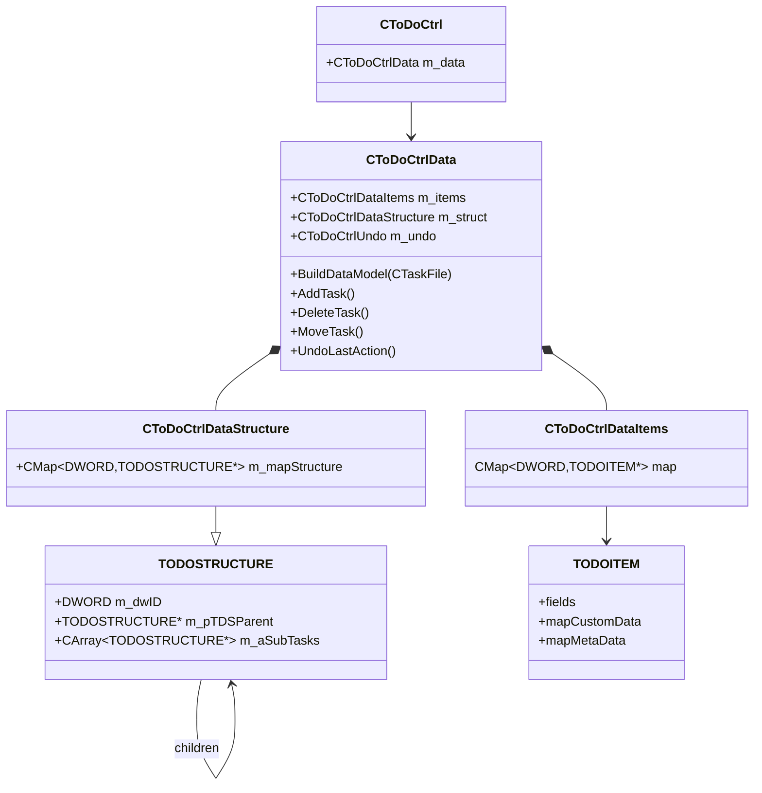

# Data Model Reference

Companion to [ARCHITECTURE.md](ARCHITECTURE.md). Source of truth:

- `Core/ToDoList/ToDoitem.h` / `ToDoitem.cpp`
- `Core/ToDoList/ToDoCtrlData.h` / `ToDoCtrlData.cpp`
- `Core/ToDoList/ToDoCtrlDataUtils.h` / `ToDoCtrlDataUtils.cpp`
- `Core/ToDoList/TDCStruct.h` / `TDCStruct.cpp`
- `Core/ToDoList/TDCEnum.h`
- `Core/Interfaces/IEnums.h` (`TDC_ATTRIBUTE`, custom-attribute flags)
- `Core/Interfaces/TasklistSchemaDef.h` (XML vocabulary)
- `Core/ToDoList/TaskFile.h` / `TaskFile.cpp`

---

## 1. Ownership graph



Key points:

- `TODOITEM` = payload; `TODOSTRUCTURE` = hierarchy. They are intentionally separate.
- The map and tree are keyed by the same `DWORD` task ID.
- Sibling order is the order of `m_aSubTasks`.
- A task may be a **reference** (`dwTaskRefID != 0`) to another task; the target is
  resolved with `GetTrueTask()` / `GetTrueTaskID()`.

---

## 2. `TODOITEM` fields

Declared in `Core/ToDoList/ToDoitem.h:162`; attributes start around line 245.

| Group | Fields |
|---|---|
| Identity / hierarchy | `DWORD dwTaskRefID` (0 = real task, otherwise reference target) |
| Text | `sTitle`, `sComments`, `sAllocBy`, `sStatus`, `sCreatedBy`, `sExternalID`, `sVersion`, `sIcon`, `sLastModifiedBy` |
| Lists | `aAllocTo`, `aCategories`, `aTags`, `aFileLinks` (`CStringArray`) |
| Dependencies | `CTDCDependencyArray aDependencies` of `TDCDEPENDENCY` |
| Dates | `COleDateTime dateStart`, `dateDue`, `dateDone`, `dateCreated`, `dateLastMod` |
| Numeric | `int nPriority`, `nPercentDone`, `nRisk` |
| Cost/time | `TDCCOST cost`, `TDCTIMEPERIOD timeEstimate`, `timeSpent` |
| Comments | `CONTENTFORMAT cfComments`, `CBinaryData customComments` |
| Flags | `BOOL bFlagged`, `bLocked` |
| Presentation | `COLORREF color` |
| Recurrence | `TDCRECURRENCE trRecurrence` |
| Custom values | protected `CTDCCustomAttributeDataMap mapCustomData` |
| 3rd-party | protected `CTDCMetaDataMap mapMetaData` |

Helper value semantics:

- `TDCTIMEPERIOD` = `double dAmount` + `TDC_UNITS nUnits`; parses/formats/converts and
  switches units while preserving the represented duration.
- `TDCCOST` = `double dAmount` + `BOOL bIsRate` (one-off cost vs rate).
- `TDCDEPENDENCY` = `DWORD dwTaskID`, `CString sTasklist` (empty = local),
  `int nDaysLeadIn`. `CTDCDependencyArray` manages local/external dependencies and
  rewrites local IDs on import/merge.

Computed helpers on `TODOITEM`: `HasStart/HasDue/HasDone`, `IsDone`, `IsDue`,
`IsRecurring`, `CanRecur`, `GetNextOccurrence`, `CalcNextOccurrences`,
`GetRemainingDueTime`, `GetStartDueDates`, custom-attribute accessors,
`GetAttributeValue`/`HasAttributeValue`.

---

## 3. Attributes, columns and custom fields

### 3.1 Fixed enums

- `TDC_ATTRIBUTE` (`Core/Interfaces/IEnums.h`) — edit/filter attribute identity, with a
  frozen order for backward compatibility, pseudo-attributes (parent ID, new/undo/delete/
  archive/paste, path, reminder, …), and **64 custom slots**
  `TDCA_CUSTOMATTRIB_FIRST..LAST`, terminated by `TDCA_ALL`.
- `TDC_COLUMN` (`Core/ToDoList/TDCEnum.h`) — column identity, including pseudo columns
  (`TDCC_COLOR`, `TDCC_STARTTIME`, `TDCC_DUETIME`, `TDCC_DONETIME`, `TDCC_CREATIONTIME`),
  64 custom columns and sentinels `TDCC_NONE` / `TDCC_CLIENT`.

`TDCMapping` maps between attributes, columns, sort IDs, date fields and time units.

### 3.2 Custom attribute definitions

`TDCCUSTOMATTRIBUTEDEFINITION` (`Core/ToDoList/TDCCustomAttributeDef.h`) stores:

- `sUniqueID`, `sLabel`, `sColumnTitle`
- `nTextAlignment` (`DT_LEFT/CENTER/RIGHT`) and column alignment
- `dwFeatures` (`TDCCAF_*`) — sort, accumulate, minimize/maximize, hide zero,
  show time-of-day, filter, inherit parent changes, etc.
- type encoded in `dwAttribType`: data type (`TDCCA_STRING/INTEGER/DOUBLE/DATE/BOOL/
  TIME/COST/CALCULATION`) + list type (`TDCCA_NOTALIST/AUTOLIST/FIXEDLIST/
  AUTOMULTILIST/FIXEDMULTILIST`)
- `aDefaultListData`, `aAutoListData`, `bEnabled`
- optional `TDCCUSTOMATTRIBUTECALCULATION`
- managed IDs `nColumnID` / `nAttributeID` assigned per slot

### 3.3 Custom attribute values

- `TDCCADATA` (`Core/ToDoList/TDCCustomAttribData.h`) is a string-backed variant with
  `sData`/`sExtra` and conversions to string, double, int, bool, date, time period, cost
  and string arrays.
- `CTDCCustomAttributeDataMap` is `CMap<CString, TDCCADATA>` keyed by attribute unique ID.
- `CTDCMetaDataMap` (`CMapStringToString`) holds plugin-only metadata.

### 3.4 Visibility state

`TDCCOLEDITVISIBILITY` (`Core/ToDoList/TDCStruct.h`) holds:

- `CTDCColumnIDMap mapVisibleColumns`
- `CTDCAttributeMap mapVisibleEdits`
- `TDL_SHOWATTRIB nShowFields` (columns / edit fields / both)
- `BOOL bShowColorEditIfAsColumns`

`TDCCOLEDITFILTERVISIBILITY` extends it for the filter bar. The task title column/field
is always visible by rule.

### 3.5 Semantics helpers

`ToDoCtrlDataUtils.h`:

| Helper | Role |
|---|---|
| `CTDCTaskFormatter` | display strings, paths, aggregated dates/times/cost/percent |
| `CTDCTaskCalculator` | done/overdue/flagged/locked, rollups, weighted percent, custom calcs |
| `CTDCTaskMatcher` | `FindTasks` / `TaskMatches` for filters and searches |
| `CTDCTaskComparer` | `CompareTasks` for single/multi-column sort |
| `CTDCTaskExporter` | export tree (all/selected/filtered) to `CTaskFile` |
| `CTDCMultiTasker` | common value or mixed across a multi-selection |
| `CTDCTaskColumnSizer` | longest-item calculation for auto column widths |
| `CTDCTaskAttributeCopier` | copy/paste attribute sets |

All of them operate on `CToDoCtrlData`, so a change in one often affects the others.

---

## 4. Editing and undo

Edit path (simplified):

1. UI asks the data layer to change an attribute.
2. `SaveEditUndo()` pushes a `TDCUNDOELEMENT` containing the old `TODOITEM` snapshot.
3. The attribute is mutated, `dateLastMod` is updated, the task is marked modified.
4. `WM_TDCN_MODIFY` is sent to the frame with affected task IDs/attributes.

Undo structures:

- `CToDoCtrlUndo` — one active action, undo stack and redo stack.
- `TDCUNDOACTION` — group type (`EDIT`, `ADD`, `DELETE`, `PASTE`, `COPY`, `MOVE`,
  `ARCHIVE`).
- `TDCUNDOELEMENT` — operation (`EDIT/ADD/DELETE/MOVE`), task/parent/prev-sibling IDs,
  flags and a full `TODOITEM` snapshot.
- Replay: undo processes normal elements in reverse and moves forward; redo processes all
  forward. Move replay is two-pass.

Constraints:

- Only one undo action at a time (`CUndoAction` RAII enforces this).
- Completing a real action clears the redo stack.
- Add/delete/move must update both `m_items` and `m_struct`.

---

## 5. Filtering and sorting structures

- `TDCFILTER` (`TDCStruct.h`): `FILTER_SHOW nShow`, `FILTER_DATE nStartBy/nDueBy`,
  title text/option, priority/risk, category/alloc-to/tags/status/alloc-by/version lists,
  `dwFlags`, user start/due dates, next-N-days, recurrence regularity, and
  `mapCustomAttrib` values.
- `TDCADVANCEDFILTER`: named filter wrapping `SEARCHPARAMS` plus flags.
- `SEARCHPARAM` / `SEARCHPARAMS` / `SEARCHRESULT` (`CResultArray`) are the advanced
  search representation.
- `TDSORT` / `TDSORTCOLUMN` / `TDSORTCOLUMNS` (`Core/ToDoList/TDCSort.h`): one or up to
  three sort columns, direction, and persistence helpers.

---

## 6. File format

Native extension: `.tdl`; root element `TODOLIST` (`TasklistSchemaDef.h`).

Representative structure:

```xml
<TODOLIST>
  <PROJECTNAME>...</PROJECTNAME>
  <FILEFORMAT>...</FILEFORMAT>
  <NEXTUNIQUEID>...</NEXTUNIQUEID>
  <CUSTOMATTRIBDEF>...</CUSTOMATTRIBDEF>
  <VISIBILITY>...</VISIBILITY>
  <TASK ID="1" POS="0" TITLE="..." PRIORITY="..." PERCENTDONE="...">
     <CATEGORY>...</CATEGORY>
     <TAG>...</TAG>
     <TIMEESTIMATE UNITS="...">...</TIMEESTIMATE>
     <DEPENDS ID="..."/>
     <DEPENDSLEADIN>...</DEPENDSLEADIN>
     <RECURRENCE>...</RECURRENCE>
     <CUSTOMATTRIB ID="..." VALUE="..."/>
     <TASK ID="2" ...>...</TASK>
  </TASK>
</TODOLIST>
```

- `TASK` attributes: `ID`, `POS`, `PARENTID`, `TITLE`, `PERSON`, `CATEGORY`, `TAG`,
  `STATUS`, `PRIORITY`, `PERCENTDONE`, `TIMEESTIMATE`, `TIMESPENT`, `RECURRENCE`,
  `DEPENDS`, `DEPENDSLEADIN`, `COST`, `RISK`, `ICONINDEX`, dates, and `CUSTOMATTRIB`
  children with `ID`/`VALUE`/`CALC`/`VALUEDISPLAY`.
- Computed/display tags may also be written (`CALCDUEDATE`, `HIGHESTPRIORITY`,
  `SUBTASKDONE`, `ISPARENT`).
- `TASKFILE_HEADER` (`TaskFile.h`) carries XML/XSL headers, project name, path, checkout
  owner, archive/Unicode flags, earliest due date, next unique ID, file version and file
  format.
- Format versions: `TDL_FILEFORMAT_SORTBYID = 9`, `CUSTATTRIB`, `RECUR_MOD`, `LOCKING`;
  `TDL_FILEFORMAT_CURRENT = NEXT - 1`. Newer formats open read-only; older formats get
  fixups.
- Encryption is handled by `CXmlFileEx` via `EncryptDecrypt.dll` (`IEncryption`); checkout
  and file-path headers remain readable because they are added after encryption.
- Backups are managed by `CTDCFileBackup`; archives are separate `.tdl` files flagged
  `ARCHIVE`.

---

## 7. Invariants checklist for data-model changes

1. Keep `m_items` and `m_struct` consistent on add/delete/move/undo.
2. Preserve task IDs across load/save and merge; references depend on IDs.
3. Update `dateLastMod` and mark modified for user-visible edits.
4. Route edits through undo so redo/undo and notifications remain correct.
5. When adding a task field, update: `TODOITEM`, `CTaskFile` read/write,
   `TasklistSchemaDef.h`, formatter/calculator/comparer/matcher as applicable, and any
   exporter/importer mapping.
6. When adding a custom attribute type/feature, update `IEnums.h`, definition validation,
   `TDCCADATA` conversion, formatting and `.tdl` encoding.
7. Keep fixed enum ordering stable; append new attribute/column IDs before sentinels and
   extend the custom slot range only with a format-version bump.
