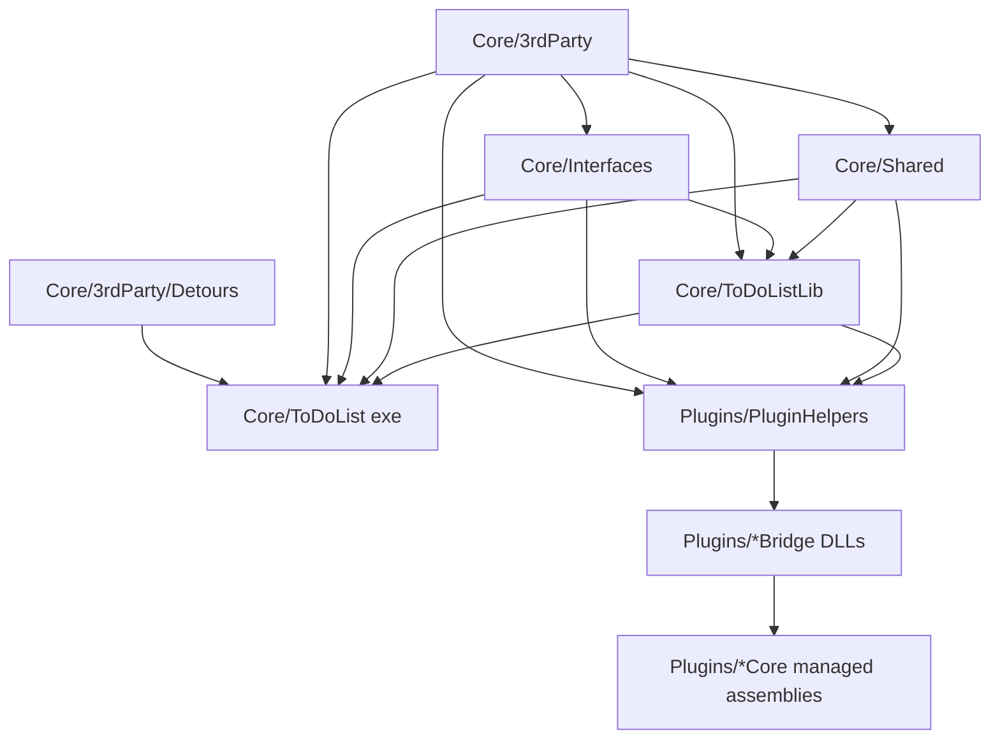

# Project Scope and Dependency Map

Companion to [ARCHITECTURE.md](docs/ARCHITECTURE.md). This file records which projects are in
scope for analyzing the core application and which can be ignored.

## 1. Analysis rule

**Start project:** `Core/ToDoList/ToDoList.vcxproj` (the application shell and entry
point). Analyze `Core/ToDoList` first.

**Always include (required dependencies):**

| Project | Why |
|---|---|
| `Core/ToDoListLib` | Compiles almost all of `Core/ToDoList/*.cpp`; linked by the exe and by plugin bridges. |
| `Core/Interfaces` | Plugin contracts and shared managers/preferences used everywhere. |
| `Core/Shared` | Generic MFC utility layer used by the app and plugins. |
| `Core/3rdParty` | Native control/graphic/XML/COM/database support used by the app. |
| `Core/3rdParty/Detours` | Produces `detours.lib`, linked directly by the exe. |

**Include only when the question concerns them:**

| Project | Scope |
|---|---|
| `Core/TDLTest` | Unit/test harness; useful to understand expected behaviour. |
| `Core/TDLUpdate` | Updater helper app; only `TDLWebUpdater.h` is included by the main app. |
| `Core/EncryptDecrypt` | Runtime DLL implementing `IEncryption`; include for encryption questions. |
| `Core/TransText` | Runtime DLL implementing `ITransText`; include for localisation questions. |
| `Core/MySpellCheck` | Runtime DLL implementing spell checking. |
| `Core/RTFContentCtrl` | Runtime DLL implementing an `IContent` editor. |
| `Core/FtpStorage` | Runtime DLL implementing `ITasklistStorage`. |
| `Core/{iCalImportExport, GPExport, FMindImportExport, MLOImport, PlainTextImport}` | Runtime import/export DLLs. |
| `Core/{GanttChartExt, CalendarExt, BurndownExt, KanbanBoard, WorkloadExt}` | Runtime `IUIExtension` view DLLs. |
| `Core/ConvertRTFToHTML` | Helper tool for RTF/HTML conversion. |

**Excluded from core analysis:**

| Project | Reason |
|---|---|
| `Core/TDLUninstall` | Separate uninstaller utility. |
| `Core/TDLTransEdit` | Separate translation editor tool. |
| Entire `Plugins/` tree | Separate solution with managed/native plugin implementations; only relevant when studying specific extensions. |

The core runtime must remain functional with **no plugin DLLs present**: built-in
import/export (CSV, TDL, HTML, TXT, Outlook), built-in plain-text comments editor,
encryption-free tasklists and normal preferences all work without optional DLLs.

---

## 2. Core solution membership

`Core/ToDoList_Core.sln` contains 26 projects:

```text
3rdParty, EncryptDecrypt, FMindImportExport, FtpStorage, GPExport,
GanttChartExt, MLOImport, MySpellCheck, TransText, RTFContentCtrl, Shared,
TDLTest, TDLUninstall, TDLUpdate, ToDoList, iCalImportExport, KanbanBoard,
CalendarExt, BurndownExt, PlainTextImport, TDLTransEdit, WorkloadExt,
Interfaces, ToDoListLib, ConvertRTFToHTML, Detours
```

Minimal solutions:

| Solution | Projects |
|---|---|
| `Core/ToDoList_Only.sln` | `3rdParty`, `Shared`, `TDLTest`, `ToDoList`, `Interfaces`, `ToDoListLib`, `TDLUpdate` |
| `Core/ToDoList_Test.sln` | `3rdParty`, `Shared`, `TDLTest`, `Interfaces`, `ToDoListLib` |
| `Plugins/ToDoList_Plugins.sln` | `PluginHelpers`, all plugin bridges/cores, `Plugins/3rdParty`, and the four Core static libs (`3rdParty`, `Interfaces`, `Shared`, `ToDoListLib`) — **not** `ToDoList.vcxproj` |

---

## 3. Build dependency graph



Notes:

- `Core/ToDoListLib` has **no `<ProjectReference>` entries**; its consumers supply the
  other three static libraries.
- Runtime plugin DLLs and the main exe scan the **executable directory only** for plugin
  factories.
- Core extension DLLs copy themselves into `Core/ToDoList/unicode_debug` /
  `unicode_release` as a post-build step.
- Plugin bridges copy into `Core/ToDoList/unicode_$(ConfigurationName)` and, in Release,
  into `Plugins/Release`; managed cores output to `bin/Debug` / `bin/Release`.

Output locations:

| Artifact | Location |
|---|---|
| Core static libs | `Core/<Project>/Unicode_Debug` or `Unicode_Release` |
| `ToDoList.exe` | `Core/ToDoList/Unicode_Debug` or `Unicode_Release`; copied to `Plugins/debug` / `Plugins/release` |
| Core runtime DLLs | `Core/<Project>/Unicode_*` → copied to `Core/ToDoList/unicode_*` |
| Plugin bridge DLLs | plugin project output → `Core/ToDoList/unicode_*` and `Plugins/Release` |

---

## 4. Build / test commands

From the repository root (Windows):

```bat
BuildDebug.bat     REM MSBuild "Unicode Debug|Win32" + TDLTest + Plugins Debug
BuildRelease.bat   REM legacy path + release build + zip scripts
```

Individual project build with modern MSBuild:

```bat
msbuild Core\ToDoList_Core.sln /t:Build /p:Configuration="Unicode Debug" /p:Platform=Win32 /m
```

Tests:

```bat
Core\TDLTest\Unicode_Debug\TDLTest.exe
```

The batch scripts reference Visual Studio 14.0 / VC6 paths even though the project files
use toolset `v143`; prefer MSBuild from a current Visual Studio installation and expect
the scripts themselves to need path updates on a modern machine.

---

## 5. Runtime plugin inventory (only for extension-level questions)

`Plugins/` is a separate solution and out of scope for core analysis. For reference:

| Category | Projects |
|---|---|
| Bridge helper | `PluginHelpers` (C++/CLI; links Core static libs) |
| Content controls | `HTMLContentControl`, `MDContentControl`, `SpreadsheetContentControl` |
| Import/export | `HTMLReportExporter`, `JSONExporter`, `MarkdeepExporter`, `OutlookExporter`, `PDFExporter`, `SampleImpExp`, `TodoTxtImpExp` |
| Storage | `MySqlStorage` |
| UI extensions | `EisenhowerUIExtension`, `EvidenceBoardUIExtension`, `LoggedTimeUIExtension`, `MindMapUIExtension`, `SampleUIExtension`, `TaskDatesUIExtension`, `WeekPlannerUIExtension`, `WordCloudUIExtension` |
| Managed/native support | large `Plugins/3rdParty` set (ReoGrid, Markdig, iText, MySql, Newtonsoft, TodoTxtLib, etc.) |

Each plugin is usually a pair: a native/C++-CLI `*Bridge` DLL exporting the ToDoList
factory and a C# `*Core` assembly implementing the UI/logic.
