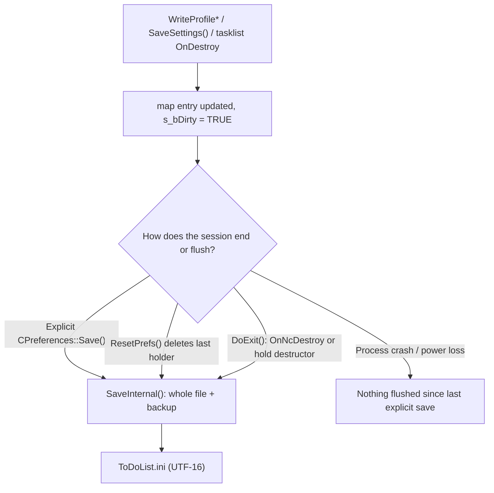

# Application State and Persistence

> Companion to [ARCHITECTURE.md](ARCHITECTURE.md) and [DATA_MODEL.md](DATA_MODEL.md).
> This document covers state that belongs to the **installation/session** rather than
> to a tasklist document: user preferences, window/session state, per-tasklist UI state
> and when any of it reaches `ToDoList.ini` (or the registry).
>
> Scope: `Core/ToDoList`, `Core/ToDoListLib`, `Core/Interfaces`, `Core/Shared`.

---

## 1. What counts as application state

| State | Owner | Stored in | Captured when |
|---|---|---|---|
| Task data and hierarchy | `CToDoCtrlData` | `.tdl` tasklist document (and archive) | Tasklist save / autosave; **not** in the INI |
| User preferences (fonts, colours, defaults, behaviour) | `CPreferencesDlg` → `CPreferences` | `[Preferences]` and plugin sections | Preferences dialog, migrations, explicit saves, exit |
| Main-window/session snapshot | `CToDoListWnd` | `[Settings]`, `[Pos]` | `SaveSettings()` during `DoExit()` only |
| Open tasklists and active tab | `CToDoListWnd::SaveSettings()` | `[Settings]` `NumLastFiles`, `LastFileN`, `LastActiveFile` | Exit |
| Per-tasklist UI state (splitter, columns, tree expansion, filter, find/replace, tab colour) | `CToDoCtrl`, `CFilteredToDoCtrl`, `CTabbedToDoCtrl` | `[FileStates\<key>]` | When the control is destroyed or reloaded, buffered until the next flush |
| MRU | `CToDoListWnd` | `[MRU]` | Exit (`SaveSettings()`); buffered on clear |
| Quick find history | `CToDoListWnd` | `[QuickFind]` | Exit |
| Find dialog state | `CTDLFindTasksDlg` | `[FindTasks]` | Dialog destruction |
| Time tracker geometry | `CTDLTimeTrackerDlg` | `[TimeTracker]` | Dialog destruction |
| Keyboard shortcuts / custom toolbar | shortcut and toolbar managers | `[KeyboardShortcuts]`, `[CustomToolbar]`, `[Toolbar]` | Preferences apply, exit |
| UI extension / content control state | `CUIExtensionMgr`, `CContentMgr` | `[UIExtensions]`, `[ContentControls]`, plus per-tasklist subkeys | Exit / preference refresh |
| Selection, undo stack, active timers, unsaved edits | in-memory objects | nowhere | Lost on exit or crash |

So the INI is a **mix of durable preferences and a session snapshot**, not a copy of the
task data.

---

## 2. Where the state lives

`CToDoListApp::InitPreferences()` chooses the store (`Core/ToDoList/ToDoList.cpp:982`):

1. `-i <path>` command line override.
2. An INI file with the same path/name as a tasklist passed on the command line
   (this also enables multi-instance mode).
3. The default INI:
   - `<exe folder>\ToDoList.ini` when that folder is writable,
   - otherwise `%APPDATA%\Abstractspoon\ToDoList\ToDoList.ini`,
   - when both exist, the more recently modified one wins
     (`Core/ToDoList/ToDoList.cpp:590-647`).
4. If no INI is available/usable, HKCU `Software\AbstractSpoon\ToDoList`
   (`Core/ToDoList/ToDoList.cpp:1173-1213`).

The format is selected at startup and can be switched later via the import/export
preferences commands. Preferences can be imported/exported between INI and registry, but
the running session keeps the chosen backend.

Under the INI backend, per-tasklist state is keyed by the tasklist path:
`FileStates\<path-with-backslashes-replaced>` and optionally a subkey
(`Core/ToDoList/ToDoCtrl.cpp:8593-8620`). `CPreferences::KeyFromFile` also strips the
drive letter for removable drives.

---

## 3. In-memory model and the write path

`CPreferences` is a process-wide static section map (`Core/Interfaces/Preferences.cpp:106-112`):

- The file is read lazily on the first `CPreferences` construction after
  initialisation, and reloaded whenever the reference count reaches zero
  (`Preferences.cpp:132-166`). A pending temporary backup from an interrupted write is
  restored first (`Preferences.cpp:146-150`).
- Every `WriteProfile*` call updates the map and, when the value actually differs, sets
  `s_bDirty` (`Preferences.cpp:523-593`, `746-763`).
- `CPreferences::Save()` returns immediately if not dirty; otherwise `SaveInternal()`
  rebuilds the **entire** file, writes `[AppVer] Version`, sorts sections and entries,
  copies the old file into `ini.Backup`, and rewrites the INI as UTF-16
  (`Preferences.cpp:300-400`, `275-284`). Backups are timestamped and culled to 10 at
  the next startup.

The critical detail for timing is the reference count:

- `CToDoListWnd` keeps a `CPreferencesDlg` alive for the whole session, and that dialog
  owns a `CPreferences` member (`Core/ToDoList/PreferencesDlg.h:370`). Therefore the
  refcount is normally **not zero** while the app is running, so a local
  `CPreferences` object going out of scope does **not** flush the file.
- Writes are flushed when the last reference goes away (notably deleting/replacing the
  prefs dialog in `ResetPrefs()`), or when `CPreferences::Save()` is called explicitly.
  `ToDoListWnd::ResetPrefs()` does `delete m_pPrefs` before constructing the replacement
  (`Core/ToDoList/ToDoListWnd.cpp:11484-11492`), which is why closing the Preferences
  dialog flushes the file at that point.

This is the main correction to the intuitive "the INI is written when a write call
returns" model: during a session, most writes are **buffered in memory** and ride along
with the next full-file flush.



---

## 4. When the INI is actually written

### 4.1 Buffered writes in the running app

These update memory but do not necessarily touch the file immediately:

- `CToDoListWnd::SaveSettings()` — writes the window/session snapshot into
  `[Settings]`/`[Pos]` (`Core/ToDoList/ToDoListWnd.cpp:2451-2529`).
- `CToDoCtrl::OnDestroy()` — saves per-tasklist tree state, splitter, column visibility,
  default recurrence and find/replace (`Core/ToDoList/ToDoCtrl.cpp:5194-5213`).
- `CToDoCtrlMgr::DeleteToDoCtrl()` — saves the tab colour (`Core/ToDoList/ToDoCtrlMgr.cpp:887-920`).
- Closing the Find dialog / time tracker writes their geometry (`TDLFindTasksDlg.cpp:1173-1198`,
  `TDLTimeTrackerDlg.cpp:1159-1175`).

### 4.2 Explicit immediate saves

`CPreferences::Save()` is called directly at these points:

| Trigger | Location |
|---|---|
| Preferences dialog accepted | `ToDoListWnd.cpp:5343` (plus flush via `ResetPrefs`) |
| Add/delete/rename advanced search | `ToDoListWnd.cpp:11295`, `11322`, `11346` |
| Clear one or more task reminders | `ToDoListWnd.cpp:13771` |
| File → Save All | `ToDoListWnd.cpp:9227-9230` → `SaveAll(..., TDLS_INCLUDEPREFERENCES)` at `11625-11626` |
| Cleanup INI preferences tool | `TDLCleanupIniPreferencesDlg.cpp:246` |
| Dark-mode colour restore (startup) | `TDCDarkMode.cpp:192` |
| First-run wizard finishing | `ToDoList.cpp:1140-1142` |

### 4.3 Session snapshot on exit

`DoExit()` is the only place that snapshots the current session:

1. `SaveAll()` saves modified tasklists.
2. `SaveSettings()` writes window placement, open tasklists, active tab, view state,
   bar visibility, MRU, quick-find, shortcuts and extension state.
3. `CPreferences hold` is created so the prefs dialog can be deleted without flushing.
4. Tasklists are closed; each `CToDoCtrl::OnDestroy()` adds its per-file UI state.
5. The final whole-file write happens once in `CToDoListWnd::OnNcDestroy()` or, on the
   Windows-shutdown path where the window is not destroyed, when `hold` leaves scope.

See `Core/ToDoList/ToDoListWnd.cpp:9312-9457`. A normal app close therefore persists
both preferences and session state; a crash does not.

### 4.4 Autosave is not a preference flush

- The autosave timer calls `AutoSaveTasklists()` → `SaveAll(TDLS_AUTOSAVE | TDLS_NOFLUSH)`
  **without** `TDLS_INCLUDEPREFERENCES` (`ToDoListWnd.cpp:7148`, `7232-7233`,
  `7577-7583`). It only saves tasklist documents.
- The "auto-save on switching applications" and "minimize to tray" paths **do** include
  preferences (`ToDoListWnd.cpp:3539-3540`, `11993-11997`). If that preference is
  enabled, every app deactivation/minimize rewrites the whole INI.
- Consequently, the INI update frequency depends on both user actions and these
  settings; it is not a fixed interval.

### 4.5 Per-tasklist state timing

`FileStates\<key>` entries are written when the tasklist window is destroyed or reloaded,
but they are only flushed with the rest of the map. Closing a tab during a session does
not guarantee the INI changed on disk; the state may sit in memory until Save All,
auto-save-on-switch, the Preferences dialog, or exit.

A tasklist can additionally store some UI state inside the `.tdl` file when the
`TDCS_SAVEUIVISINTASKLIST` style is set (`Core/ToDoList/ToDoCtrl.cpp:8662-8691`); that
travels with the document, not the INI.

### 4.6 Crash and interrupted-write behaviour

- Unflushed in-memory changes (including session state not yet snapshotted) are lost on
  a crash or forced termination.
- `SaveInternal()` writes via `CFile::modeCreate` (truncate) rather than a
  temp-file-and-rename. The timestamped `ini.Backup` copy is the recovery path; a
  pending backup is restored on the next `CPreferences` load.
- Because every flush rewrites the complete file, frequent explicit saves on high-rate
  UI events would be expensive; the code deliberately buffers most state.

### 4.7 Registry backend

When `bIni` is false, `GetProfile*`/`WriteProfile*` go straight to HKCU
(`Preferences.cpp:436-544`). There is no buffered whole-file flush; individual values are
written as they change. The exit-only session snapshot still happens only in `DoExit()`.

---

## 5. Historical state-loss paths (6.9.6) and current guards

The sibling source tree `todolist_src.6.9.6` (close to, but not identical with, 6.8.10)
contains several code paths that could replace or erase a tasklist's stored
`FileStates\<key>` state without the user modifying the document. They are recorded here
because they directly explain the "state reverts to defaults and everything is collapsed"
symptom.

### 5.1 An empty filtered tree erased the saved expansion

In 6.9.6, `CToDoCtrl::SaveExpandedState()` guarded only on the **data** task count:

```cpp
// todolist_src.6.9.6/ToDoList/ToDoCtrl.cpp:14645
if (GetTaskCount() == 0)
    return;

CString sKey = GetPreferencesKey(_T("ExpandedState"));
// ...
prefs.DeleteSection(sKey);
int nCount = SaveTreeExpandedState(prefs, sKey); // walks tree items only
prefs.WriteProfileInt(sKey, _T("Count"), nCount);
```

`GetTaskCount()` is the data-map count (`ToDoCtrl.h:366` → `ToDoCtrlData.h:53`), not the
number of items currently in the tree. If a filter hides every task, the data count is
still non-zero while the tree has zero items. `SaveTreeExpandedState()` then saved nothing,
and the section was left with `Count=0`. `LoadTreeExpandedState()` treats a zero count as
"no saved state", which means **all tasks open collapsed**.

Current code checks the tree instead of the data, and returns before touching the saved
section:

```cpp
// Core/ToDoList/TDLTaskTreeCtrl.cpp:2209
// Don't overwrite previous state if we have no tasks
if (GetItemCount() == 0)
    return;
```

So an empty or fully filtered view can no longer destroy `ExpandedItems`.

### 5.2 Delay-loaded tasklists could write partial/default state

In 6.9.6:

- `CFilteredToDoCtrl::DelayLoad()` called `LoadSettings()` immediately
  (`todolist_src.6.9.6/ToDoList/FilteredToDoCtrl.cpp:177-186`).
- `CFilteredToDoCtrl::OnDestroy()` called `SaveSettings()` unconditionally, including for
  a tasklist that had only been delay-loaded (`FilteredToDoCtrl.cpp:429-434`).
- `CTabbedToDoCtrl::OnDestroy()` saved view state whenever `GetView() != FTCV_UNSET`
  (`TabbedToDoCtrl.cpp:275-320`); a delay-loaded tasklist can carry default/partial view
  state rather than the state stored in the INI.

`CToDoCtrl::OnDestroy()` itself had a `!m_bDelayLoaded` guard already
(`todolist_src.6.9.6/ToDoList/ToDoCtrl.cpp:8358-8380`), but the derived classes did not.
This is the path that matches "restored at startup but not opened for several days, then
parts of its state are gone": the session exits without ever activating the tab, and the
derived classes can write default/partial filter or view state back to `FileStates`.
(The expansion state has the separate wipe paths described in 5.1 and 5.3.)

Current code guards all three levels:

- `CFilteredToDoCtrl::OnDestroy()` only calls `SaveState()` when `!m_bDelayLoaded`
  (`Core/ToDoList/FilteredToDoCtrl.cpp:246-252`).
- `CTabbedToDoCtrl::OnDestroy()` has the same guard
  (`Core/ToDoList/TabbedToDoCtrl.cpp:770-774`).
- `CFilteredToDoCtrl::LoadTasks()` no longer saves while delay-loaded
  (`Core/ToDoList/FilteredToDoCtrl.cpp:155-158`), and the old `DelayLoad()` override that
  called `LoadSettings()` was removed.

This is the "loss-of-state fix" merged from 8.1 (`890ec8ad7`, 2021-12-19). 6.8.10/6.9.6
predate it.

### 5.3 Filter refresh persisted transient expansion

In 6.9.6, `CFilteredToDoCtrl::RefreshTreeFilter()` used a session `CPreferences` object
to save and restore expansion around the rebuild:

```cpp
// todolist_src.6.9.6/ToDoList/FilteredToDoCtrl.cpp:1261
CPreferences prefs;
SaveExpandedState(prefs);   // line 1286, rewrites the persistent section
// ... rebuild tree with the filter ...
LoadExpandedState(prefs);   // line 1308
```

Because `CPreferences` is the process-wide in-memory map, this did not merely cache the
transient filtered tree: it replaced the persisted `ExpandedState` section with the
expanded set of the filtered tree. Filtering out most tasks and then exiting therefore left
only those tasks' expansion saved; the next unfiltered open showed everything else
collapsed.

Current `CToDoCtrl::RebuildTree()` caches expanded task IDs in a local `CDWordArray`,
rebuilds, and restores them in memory (`Core/ToDoList/ToDoCtrl.cpp:7550-7598`);
`CFilteredToDoCtrl::RefreshTreeFilter()` no longer touches preferences
(`Core/ToDoList/FilteredToDoCtrl.cpp:567-596`). Filtering is therefore no longer a
persistent write.

### 5.4 Secondary: INI rollback differences

The 6.9.6 preference backend also differs in a way that can look like "state lost":

- It kept a single `ToDoList.bak.ini`, copied it before every write, and on the next
  startup copied it back over `ToDoList.ini` if it still existed
  (`todolist_src.6.9.6/Shared/Preferences.cpp:56-132`, `157-229`).
- When the last `CPreferences` object was destroyed it wrote the file and then cleared the
  entire in-memory section map (`Shared/Preferences.cpp:134-154`).

An interrupted write could therefore leave the `.bak.ini` in place and cause a rollback on
the next start. The current backend keeps the map until the next load, restores only a
pending temporary backup, and keeps timestamped backups under `ini.Backup`
(`Core/Interfaces/Preferences.cpp:132-184`, `275-284`, `384-395`). This is a robustness
change rather than the main cause of the collapsed-tree symptom, but it explains some
older reports of state reverting after a restart.

### 5.5 Verdict for 6.8.10/6.9.6 behaviour

- There is **no age-based expiry** of `FileStates` in the current code; entries persist
  until the explicit Tools → Cleanup INI Preferences command removes them. "Not opened for
  several days" is therefore almost certainly "restarted/closed without opening", not
  elapsed time.
- The three direct state-clobbering paths above are all fixed or guarded in the current
  tree. A tasklist that is restored but not opened no longer writes default/partial state
  over its `FileStates` entry, and an empty filtered tree no longer erases expansion.
- State already overwritten by an old version remains default until the tasklist is opened,
  adjusted, and closed normally.
- Remaining limitation: saving still records the expansion of the tree as currently
  built. If you exit while a restrictive filter is active, only the expanded nodes present
  in that filtered tree are stored; unfiltered-out nodes may need expanding again. This is
  narrowing, not the total state loss described above.
- As elsewhere in this document, a crash or forced termination still loses changes that
  have not yet been flushed from the in-memory preference map.

---

## 6. Startup read path

1. `InitPreferences()` selects the backend and loads the INI (or opens the registry key).
   It also writes language/dark-mode choices and runs preference migrations
   (`ToDoList.cpp:982-1171`, `1266-1351`).
2. The main window reads `[Settings]` in `LoadSettings()` (`ToDoListWnd.cpp:2787-2845`).
3. `OnPostOnCreate()` restores visibility/position, then reopens the last tasklists and
   active tab (`ToDoListWnd.cpp:2603`, `2645-2726`).
4. Each `CToDoCtrl::LoadTasks()` reads its `FileStates\<key>` state and restores sort,
   expansion, splitter, column visibility and find/replace
   (`Core/ToDoList/ToDoCtrl.cpp:4676-4741`, `4765`, `8593-8708`).

Delay-loaded tasklists skip some UI work until first activation; their window is not
created until needed, so their `OnDestroy()`-based state save is not involved for tabs
that are never opened in that session.

---

## 7. Practical implications for changes

- To add persistent application state, put it in `CPreferencesDlg` save/load (for user
  preferences) or in `CToDoListWnd::SaveSettings()`/`LoadSettings()` (for session
  state). Do not add a new state file.
- Assume exit-only durability unless you also call `CPreferences::Save()` at the change
  site. Follow the advanced-filter and reminder code if the state must survive a crash.
- Do not call `Save()` from high-frequency handlers (scroll, size, edit, timer ticks):
  each call rewrites the entire INI and creates a backup.
- Do not assume "tab closed" means "INI written"; per-tasklist state is buffered.
- Two processes sharing one INI keep independent in-memory maps and the last flush wins
  the whole file. The tasklist-adjacent INI mode (`-i`/matching INI plus the
  `MultiInstance` preference) exists to let instances have separate state.
- Tasklist document format changes are a separate concern; see
  [DATA_MODEL.md](DATA_MODEL.md) and the file-format invariants in
  [ARCHITECTURE.md](ARCHITECTURE.md).

---

## 8. Evidence index

| Topic | Source |
|---|---|
| Backend selection / default INI path | `Core/ToDoList/ToDoList.cpp:590-647`, `982-1042`, `1173-1213` |
| First-run and preference migration writes | `Core/ToDoList/ToDoList.cpp:1140-1142`, `1266-1351` |
| Load / dirty / save / backup / UTF-16 | `Core/Interfaces/Preferences.cpp:132-184`, `300-400` |
| Backup retention | `Core/Interfaces/Preferences.cpp:275-284`, `Core/Interfaces/Preferences.h:63` |
| Long-lived prefs holder | `Core/ToDoList/PreferencesDlg.h:370`, `Core/ToDoList/ToDoListWnd.cpp:11484-11492` |
| Session snapshot | `Core/ToDoList/ToDoListWnd.cpp:2451-2529`, `9312-9457` |
| Explicit saves | `Core/ToDoList/ToDoListWnd.cpp:5343`, `11295`, `11322`, `11346`, `11625-11626`, `13771` |
| Autosave behaviour | `Core/ToDoList/ToDoListWnd.cpp:3539-3540`, `7148`, `7232-7233`, `7577-7583`, `11993-11997` |
| Per-tasklist state | `Core/ToDoList/ToDoCtrl.cpp:5194-5213`, `8593-8708`; `Core/ToDoList/FilteredToDoCtrl.cpp:234-242`, `1318-1338` |
| 6.9.6: empty tree overwrote expansion | `todolist_src.6.9.6/ToDoList/ToDoCtrl.cpp:14645-14747`, `ToDoCtrl.h:366`; current guard `Core/ToDoList/TDLTaskTreeCtrl.cpp:2209-2225` |
| 6.9.6: delay-loaded save path | `todolist_src.6.9.6/ToDoList/FilteredToDoCtrl.cpp:177-186`, `429-434`; current guards `Core/ToDoList/FilteredToDoCtrl.cpp:155-158`, `246-252`, `Core/ToDoList/TabbedToDoCtrl.cpp:770-774` |
| 6.9.6: filter refresh persisted expansion | `todolist_src.6.9.6/ToDoList/FilteredToDoCtrl.cpp:1261-1312`; current `Core/ToDoList/ToDoCtrl.cpp:7550-7598`, `Core/ToDoList/FilteredToDoCtrl.cpp:567-596` |
| 6.9.6: INI rollback / map clearing | `todolist_src.6.9.6/Shared/Preferences.cpp:56-154`, `157-229`; current `Core/Interfaces/Preferences.cpp:132-184` |
| Loss-of-state fix commit | `890ec8ad7` (2021-12-19, merged from ToDoList_8.1) |
| Tasklist manager tab colour | `Core/ToDoList/ToDoCtrlMgr.cpp:887-920` |
| Dialog state | `Core/ToDoList/TDLFindTasksDlg.cpp:1173-1198`, `Core/ToDoList/TDLTimeTrackerDlg.cpp:1159-1175` |